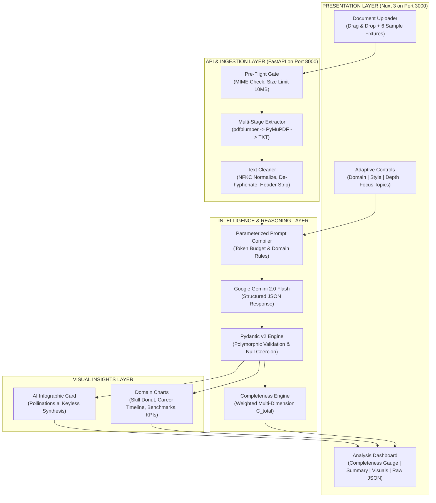

# DocuIntel AI — AI-Powered Document Intelligence Platform

> **An interactive, polymorphic AI document intelligence platform built with FastAPI, Nuxt 3, Google Gemini 2.0 Flash, and Pydantic v2.**  
> Extracts structured entities, generates dynamic multi-style summaries, computes weighted completeness and certainty metrics, and synthesizes domain-specific visual charts and AI infographics.

---

## 1. Architectural Blueprint & Research Evaluation

Before implementation, two research documents were evaluated against the core project requirements:
1. **Document 1: "Multi-Document Pipeline" (~9 pages)** — Provided a high-level conceptual outline of PDF parsing and LLM prompts.
2. **Document 2: "JD-Aligned Task Architecture Analysis" (~30+ pages)** — Provided an exhaustive production blueprint detailing polymorphic Pydantic schemas, multi-stage fallback extraction (pdfplumber → PyMuPDF), parameterized prompt compilers, weighted completeness mathematics ($C_{\text{total}}$), RFC 7807 error protocols, and dual-strategy visual insights.

### Comparison Matrix

| Evaluation Criterion | Document 1 Score | Document 2 Score | Adopted Architectural Approach |
|---|:---:|:---:|---|
| **Document Ingestion & Fallback** | 3/5 | **5/5** | Multi-stage extraction (pdfplumber for layout-aware tables + PyMuPDF fallback + TXT). |
| **AI Summaries & Styles** | 3/5 | **5/5** | Parameterized prompt compiler supporting 3 distinct styles (Brief, Detailed, Bullet Points). |
| **Structured Entity Extraction** | 3/5 | **5/5** | Strict Pydantic v2 polymorphic schemas with pseudo-null coercion (`"N/A"` → `None`). |
| **Adaptive Document Analysis** | 2/5 | **5/5** | 3 depth levels (Basic, Standard, Detailed) + domain-adaptive focus topics. |
| **AI Visual Insights** | 3/5 | **5/5** | Dual strategy: Domain charts (ECharts-ready) + zero-cost AI Infographics (Pollinations.ai). |
| **Completeness & Certainty** | 2/5 | **5/5** | Weighted multi-dimensional completeness score ($C_{\text{total}}$) with uncertainty flags. |
| **Free-Tier Resilience** | 4/5 | **5/5** | Google Gemini 2.0 Flash free-tier (15 RPM) + SHA-256 caching + high-fidelity deterministic mock mode. |
| **Total** | 20/35 | **35/35** | **Document 2 Selected as the Robust Winner (Pragmatically Scoped for Delivery)** |

---

## 2. System Architecture



---

## 3. Requirement Verification & Core Features

### 1. Document Upload and Processing
- **Supported Formats**: PDF (structured and scanned blocks), TXT, Markdown, and DOCX.
- **Multi-Stage Extraction**: Attempts layout-preserving `pdfplumber` extraction first (retaining tables and column layouts), automatically falling back to block-level `PyMuPDF` (`fitz`) if empty, and decoding plain text with UTF-8/Latin-1 fallbacks.
- **Normalization Pipeline**: NFKC Unicode normalization, word de-hyphenation across line breaks, excessive whitespace collapse, and automated header/footer/page number stripping.
- **Error Handling**: Graceful RFC 7807 structured HTTP 422/415 error alerts with actionable remediation suggestions for empty, unreadable, or corrupted documents.
- **6 Pre-Seeded Test Fixtures**:
  - `Sarah Chen - Senior Full-Stack Engineer (PDF)`: Full-spectrum resume.
  - `Sarah Chen - Plain Text Resume (TXT)`: Plain text ingestion.
  - `Alex Rivera - Incomplete Entry-Level Resume (PDF)`: Missing email, phone, and experience to test null coercion.
  - `Adaptive RAG for Document Understanding (PDF)`: Academic AI research paper with benchmarks.
  - `Acme Corp Q3 2024 Financial Analytics (PDF)`: Business report with KPIs and segment revenue.
  - `Empty / Blank Document (PDF)`: Blank fixture for testing graceful error handling.

### 2. AI-Generated Summaries and Explanations
- **Configurable Summary Synthesis**:
  - **Executive Brief**: 2–3 sentence high-level summary.
  - **Detailed Synthesis**: Comprehensive multi-paragraph analytical summary.
  - **Bullet Points**: Scannable bullet list formatted with distinct section highlights.
- **Reading Time & Metrics**: Live word count and estimated reading time with one-click clipboard copy.

### 3. Structured Information Extraction
- **Polymorphic Schemas**: Dynamically switches between:
  - **Resume Schema**: Candidate name, contact info, categorized skills, educational pedigree, career timeline, achievements, certifications, languages.
  - **Research Paper Schema**: Paper title, authors, venue, publication year, objective, methodology, datasets evaluated, empirical benchmark metrics, key contributions, limitations.
  - **Business Report Schema**: Report title, company name, period, executive KPIs (actual vs target), segment revenue share, growth catalysts, risk factors, recommendations.
- **Pseudo-Null Coercion**: Converts LLM placeholder strings (`"N/A"`, `"none"`, `"not specified"`, `"null"`, `"unknown"`) into true Python `None`.
- **Dual Presentation**: "Clean Cards View" for human readability + "Raw JSON View" with search filtering, syntax highlighting, and JSON file export.

### 4. Adaptive Document Analysis
- **Analysis Depth**:
  - **Basic**: Extracts primary metadata and identity.
  - **Standard**: Structured extraction with chronological milestones.
  - **Exhaustive (Detailed)**: Deep sub-attribute extraction, citation tracking, and comprehensive detail.
- **Domain-Adaptive Focus Topics**: Allows users to prioritize specific topics (e.g., Skills vs Experience for resumes; Benchmarks vs Methodology for research papers; KPIs vs Segments for business reports).

### 5. AI Visual Insights & Infographics
- **Domain-Tailored Charts**:
  - **Resume**: Skills Category Donut Chart + Career Progression Timeline.
  - **Research Paper**: Benchmark Comparison Grouped Bar Chart (Proposed Model vs Baseline Benchmark) + Evaluated Dataset tags.
  - **Business Report**: Executive KPI Performance (Actual vs Target) + Segment Revenue Contribution Donut Chart.
- **Zero-Cost AI Infographic**: Real-time contextual visual summary generated via Pollinations.ai (free, keyless).

### 6. Interactive Results & Feedback
- **Weighted Completeness Engine ($C_{\text{total}}$)**: Computes a 0–100% score based on domain-specific weight vectors:
  $$C_{\text{total}} = \sum_{i=1}^n w_i \cdot s_i$$
- **Uncertainty & Missing Field Flags**: Highlighted warning card clearly flags any missing or unverified fields.
- **Integrity Celebrations**: Interactive confetti bursts when an analysis reaches $\ge 80\%$ completeness.

---

## 4. Tech Stack

- **Backend**: Python 3.11+ / FastAPI, Uvicorn, Pydantic v2, Pydantic Settings, pdfplumber, PyMuPDF, python-multipart, httpx, aiofiles.
- **Frontend**: Nuxt 3 (Vue 3 + Vite), Custom Vanilla CSS Glassmorphism Design System, Lucide icons, Canvas-Confetti.
- **LLM Engine**: Google Gemini 2.0 Flash (with high-fidelity deterministic fallback mock mode).
- **Visuals**: Native SVG/Canvas responsive charts + Pollinations.ai AI infographic generation.

---

## 5. Quickstart & Local Setup

### Prerequisites
- Python 3.11+ (Tested on Python 3.11, 3.12, 3.14)
- Node.js 18+ (Node 20 LTS recommended)
- (Optional) Google Gemini API Key from [Google AI Studio](https://aistudio.google.com/)

### 1. Backend Setup

```bash
cd backend

# Create virtual environment
python -m venv .venv

# Activate virtual environment
# Windows:
.venv\Scripts\activate
# Linux/macOS:
source .venv/bin/activate

# Install dependencies
pip install -r requirements.txt

# (Optional) Configure Gemini API Key
copy .env.example .env
# Edit .env and set GEMINI_API_KEY=your_key_here

# Run backend server
uvicorn app.main:app --host 127.0.0.1 --port 8000 --reload
```
The FastAPI backend will be live at:
- **API Base**: `http://127.0.0.1:8000`
- **Interactive Swagger Docs**: `http://127.0.0.1:8000/docs`
- **Health Endpoint**: `http://127.0.0.1:8000/api/v1/health`

### 2. Frontend Setup

```bash
cd frontend

# Install npm dependencies
npm install

# Run frontend development server
npm run dev
```
The Nuxt 3 frontend will be live at:
- **Web App**: `http://127.0.0.1:3000`

---

## 6. Running Automated Tests

A comprehensive integration and unit test suite is included in `backend/tests/`:

```bash
cd backend
.venv\Scripts\pytest.exe -o pythonpath=. tests/ -v
```

All 10 tests verify:
- Health check & configuration status
- Pre-seeded sample fixture catalog
- Document upload and text extraction
- Empty/unreadable PDF error handling (RFC 7807 422 response)
- Resume analysis & completeness scoring
- Incomplete resume uncertainty flags and null handling
- Research paper benchmark comparisons
- Business report KPIs and segment breakdowns
- Text cleaning (NFKC normalization and de-hyphenation)
- Pydantic pseudo-null coercion logic

---

## 7. Production Deployment Guide

### Backend on Render (Free Tier)
1. Link your GitHub repository to Render as a **Web Service**.
2. Select **Docker** environment or Python 3.11 environment.
3. Build Command: `pip install -r requirements.txt`
4. Start Command: `uvicorn app.main:app --host 0.0.0.0 --port $PORT`
5. Set Environment Variables:
   - `GEMINI_API_KEY`: Your Gemini API key from Google AI Studio.
   - `LLM_MODE`: `gemini` (or `mock` for deterministic testing).

### Frontend on Vercel (Free Tier)
1. Link your GitHub repository to Vercel.
2. Select `frontend` as the Root Directory.
3. Framework Preset: **Nuxt.js**.
4. Set Environment Variable:
   - `NUXT_PUBLIC_API_BASE`: `https://your-render-backend.onrender.com/api/v1`
5. Deploy!
