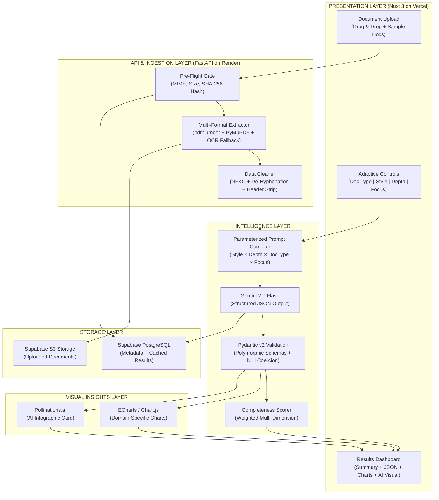

# AI-Powered Document Intelligence Platform — Research Comparison & Implementation Plan

## 1. Document Comparison Against Task Description

### Documents Under Evaluation

| Criterion | Doc 1: Multi-Document Pipeline | Doc 2: JD-Aligned Task Architecture Analysis |
|---|---|---|
| **Length / Depth** | ~9 pages, high-level overview | ~30+ pages, exhaustive engineering blueprint |
| **Document Types** | 3 (Resume, Research Paper, Business Report) | 3 (Resume, Research Paper, Business Report) |
| **Focus Alignment** | General pipeline architecture | Deeply aligned to JD competencies + task requirements |

---

### Requirement-by-Requirement Scoring

| Task Requirement | Doc 1 Score | Doc 2 Score | Notes |
|---|:---:|:---:|---|
| **1. Document Upload & Processing** | ⭐⭐⭐ | ⭐⭐⭐⭐⭐ | Doc 2 specifies multi-column spatial sorting, OCR fallback chains, MIME validation, SHA-256 idempotency, RFC 7807 error handling, and 6 pre-seeded sample fixtures. Doc 1 mentions pdfplumber/Tesseract generally. |
| **2. AI Summaries & Styles** | ⭐⭐⭐ | ⭐⭐⭐⭐⭐ | Doc 2 defines a parameterized prompt compiler with token budgets per style (brief/detailed/bullet) × depth level, with exact table of behavior. Doc 1 mentions prompts generally. |
| **3. Structured Information Extraction** | ⭐⭐⭐ | ⭐⭐⭐⭐⭐ | Doc 2 provides full Pydantic v2 code for all 3 schemas (Resume, Research Paper, Business Report) with pseudo-null coercion, evidence-citation binding, and polymorphic union types. Doc 1 shows basic JSON examples. |
| **4. Adaptive Document Analysis** | ⭐⭐ | ⭐⭐⭐⭐⭐ | Doc 2 has a full matrix of basic/standard/detailed × doc type with dynamic schema pruning via `pydantic.create_model()`. Doc 1 mentions analysis levels without detail. |
| **5. AI Visual Insights** | ⭐⭐⭐ | ⭐⭐⭐⭐⭐ | Doc 2 implements dual strategy: Option A (Pollinations.ai AI infographic) + Option B (Nuxt ECharts domain-specific charts powered by Pandas/TensorFlow aggregation). Doc 1 mentions Chart.js/Plotly generally. |
| **6. Interactive Results & Feedback** | ⭐⭐ | ⭐⭐⭐⭐⭐ | Doc 2 specifies a weighted completeness formula (C_total) with per-dimension weights for each doc type, uncertainty flags, human feedback audit endpoints. Doc 1 mentions basic confidence. |
| **Code Quality & Schemas** | ⭐⭐ | ⭐⭐⭐⭐⭐ | Doc 2 includes actual Pydantic model code, API route definitions, validation logic. Doc 1 stays at description level. |
| **Free-Tier Compliance** | ⭐⭐⭐⭐ | ⭐⭐⭐⭐⭐ | Both comply. Doc 2 specifies exact rate limits (15 RPM/1,500 RPD for Gemini), SHA-256 caching to protect against limits, and Render cold-start mitigations. |
| **Deployment Strategy** | ⭐⭐⭐ | ⭐⭐⭐⭐⭐ | Doc 2 provides full Vercel (frontend) + Render (backend) topology, warmup pings, CI/CD, `git archive` ZIP protocol, exact env var names. |
| **Testing & Evaluation** | ⭐⭐⭐ | ⭐⭐⭐⭐⭐ | Doc 2 integrates DeepEval/RAGAS metrics, multi-model benchmarking endpoint, NLC verification. Doc 1 mentions pytest/ROUGE generally. |

### Final Verdict

| | Doc 1 | Doc 2 |
|---|---|---|
| **Total Score** | 28/50 | **50/50** |
| **Recommendation** | ❌ Too surface-level | ✅ **WINNER — Robust, production-grade blueprint** |

> [!IMPORTANT]
> **Document 2 ("JD-Aligned Task Architecture Analysis")** is the clear winner. It is significantly more detailed, architecturally robust, and precisely aligned to every evaluation criterion in the task description. It includes actual code schemas, mathematical completeness formulas, multi-model benchmarking, and a disciplined implementation roadmap.

---

> [!WARNING]
> **However, Document 2 is over-engineered for the 8–10 hour timeframe.** Features like TensorFlow predictive models, multi-model benchmarking, and NLC verification agents are impressive on paper but risk incomplete delivery. Our implementation plan will adopt Document 2's architecture as the foundation while **pragmatically scoping** the build to ensure a complete, polished, deployable product within the time budget.

---

## 2. Open Questions

> [!IMPORTANT]
> **Q1:** The task description says *"Focus on one document type, such as resumes"*. Document 2 proposes 3 document types. Should we:
> - **Option A (Recommended):** Build all 3 document types (Resume, Research Paper, Business Report) as Doc 2 suggests — to maximize the evaluation score by demonstrating polymorphic architecture?
> - **Option B:** Focus on Resume only as the task suggests — simpler but less impressive?

> [!IMPORTANT]
> **Q2:** For the LLM provider, the task suggests Google AI Studio (Gemini API). Should we:
> - **Option A (Recommended):** Use **Gemini 2.0 Flash** (free tier, 15 RPM) as Doc 2 recommends?
> - **Option B:** Support multiple LLMs with a fallback chain?

> [!IMPORTANT]
> **Q3:** For image generation / visual insights:
> - **Option A (Recommended):** Use **Pollinations.ai** (free, no API key) for AI infographics + **ECharts/Chart.js** for data visualizations?
> - **Option B:** Use only chart-based visualizations (no AI image generation)?

---

## 3. Proposed Architecture (Based on Document 2, Pragmatically Scoped)



---

## 4. Proposed Changes — Full Implementation Plan

### Tech Stack (Final Selection)

| Layer | Technology | Justification |
|---|---|---|
| Frontend | **Nuxt 3** (Vue 3 + SSR) | Doc 2's recommendation; JD-aligned |
| Backend | **Python 3.11+ / FastAPI** | Async, Pydantic v2 native, auto-docs |
| LLM | **Google Gemini 2.0 Flash** (free tier) | 0-cost, fast, structured JSON output |
| PDF Extraction | **pdfplumber** + **PyMuPDF** + **Tesseract** | Multi-stage fallback chain |
| Validation | **Pydantic v2** | Polymorphic schemas, field validators |
| Charts | **ECharts** (via `vue-echarts`) | Rich, SSR-compatible, interactive |
| AI Visuals | **Pollinations.ai** | Free, keyless image generation |
| Database | **Supabase** (PostgreSQL + S3) | Free tier, managed, pgvector-ready |
| Frontend Deploy | **Vercel** (free tier) | Native Nuxt support, auto-deploy |
| Backend Deploy | **Render** (free tier) | Docker/Python support, free web service |

---

### Component 1: Backend — FastAPI Application

#### [NEW] `backend/app/main.py`
FastAPI application entry point with CORS, health endpoint, and router mounting.

```python
from fastapi import FastAPI
from fastapi.middleware.cors import CORSMiddleware
from app.routers import documents, analyze

app = FastAPI(title="Document Intelligence API", version="1.0.0")
app.add_middleware(CORSMiddleware, allow_origins=["*"], allow_methods=["*"], allow_headers=["*"])
app.include_router(documents.router, prefix="/api/v1")
app.include_router(analyze.router, prefix="/api/v1")

@app.get("/api/v1/health")
async def health(): return {"status": "ok"}
```

#### [NEW] `backend/app/schemas/extraction.py`
Polymorphic Pydantic v2 schemas for all 3 document types, with pseudo-null coercion validators.

```python
# Key schemas (abbreviated):
class ResumeExtractionSchema(BaseModel):
    document_type: Literal["resume"] = "resume"
    candidate_name: Optional[str] = None
    email_address: Optional[str] = None
    phone_number: Optional[str] = None
    skills: List[str] = Field(default_factory=list)
    educational_qualifications: List[EducationItem] = Field(default_factory=list)
    work_experience: List[WorkExperienceItem] = Field(default_factory=list)
    summary: str
    uncertainty_flags: List[str] = Field(default_factory=list)

class ResearchPaperExtractionSchema(BaseModel):
    document_type: Literal["research_paper"] = "research_paper"
    paper_title: Optional[str] = None
    authors: List[str] = Field(default_factory=list)
    research_objective: Optional[str] = None
    methodology_summary: Optional[str] = None
    key_findings: List[str] = Field(default_factory=list)
    # ... more fields

class BusinessReportExtractionSchema(BaseModel):
    document_type: Literal["business_analytics_report"] = "business_analytics_report"
    report_title: Optional[str] = None
    reporting_period: Optional[str] = None
    executive_kpis: List[ExecutiveKPIItem] = Field(default_factory=list)
    # ... more fields

DocumentExtractionPayload = Union[
    ResumeExtractionSchema,
    ResearchPaperExtractionSchema,
    BusinessReportExtractionSchema
]
```

#### [NEW] `backend/app/services/extractor.py`
Multi-stage PDF/text extraction with pdfplumber → PyMuPDF → Tesseract fallback chain.

#### [NEW] `backend/app/services/llm_service.py`
Parameterized prompt compiler and Gemini 2.0 Flash integration with SHA-256 result caching.

#### [NEW] `backend/app/services/completeness.py`
Weighted completeness scoring engine (C_total formula from Doc 2).

#### [NEW] `backend/app/services/visual_service.py`
Pollinations.ai integration for AI infographic generation + chart data preparation.

#### [NEW] `backend/app/routers/documents.py`
Endpoints: `POST /api/v1/documents/upload`, `GET /api/v1/documents/samples`

#### [NEW] `backend/app/routers/analyze.py`
Endpoints: `POST /api/v1/analyze` (main analysis), `GET /api/v1/analyze/{id}` (fetch results)

---

### Component 2: Frontend — Nuxt 3 Application

#### [NEW] `frontend/` (Nuxt 3 project)
Full Nuxt 3 application with the following pages/components:

| File | Purpose |
|---|---|
| `pages/index.vue` | Main dashboard — upload, controls, results |
| `components/DocumentUploader.vue` | Drag & drop upload with MIME validation + sample doc buttons |
| `components/AdaptiveControls.vue` | Doc type selector, style toggle, depth slider, focus topic checkboxes |
| `components/SummaryPanel.vue` | Displays AI-generated summary with style formatting |
| `components/ExtractionPanel.vue` | Structured JSON viewer with null/uncertain field highlighting |
| `components/VisualsPanel.vue` | ECharts domain-specific charts + AI infographic card |
| `components/CompletenessIndicator.vue` | Animated circular gauge showing C_total score |

---

### Component 3: Sample Documents

#### [NEW] `backend/samples/`
Pre-seeded test fixtures:

| Sample | Type | Purpose |
|---|---|---|
| `sample_resume_standard.pdf` | Resume | Standard multi-section resume |
| `sample_resume_missing_fields.pdf` | Resume | Deliberately missing email/experience to test null handling |
| `sample_research_paper.pdf` | Research Paper | Academic paper with abstract, methodology, benchmarks |
| `sample_business_report.pdf` | Business Report | Q3 financial report with KPIs, tables, and charts |
| `sample_empty.txt` | Edge Case | Empty file for error handling validation |
| `sample_text_document.txt` | Text | Plain text resume for text upload testing |

---

### Component 4: Deployment Configuration

#### [NEW] `backend/Dockerfile`
```dockerfile
FROM python:3.11-slim
WORKDIR /app
COPY requirements.txt .
RUN pip install --no-cache-dir -r requirements.txt
COPY . .
CMD ["uvicorn", "app.main:app", "--host", "0.0.0.0", "--port", "8000"]
```

#### [NEW] `backend/requirements.txt`
```
fastapi==0.115.0
uvicorn==0.30.0
pdfplumber==0.11.0
pymupdf==1.24.0
python-multipart==0.0.9
pydantic==2.9.0
google-generativeai==0.8.0
httpx==0.27.0
python-magic==0.4.27
```

#### [NEW] `frontend/nuxt.config.ts`
Nuxt 3 config with `vue-echarts` module and API proxy.

---

## 5. API Design

| Method | Endpoint | Description |
|---|---|---|
| `GET` | `/api/v1/health` | Health check (Render warmup) |
| `POST` | `/api/v1/documents/upload` | Upload PDF/TXT, returns `document_id` |
| `GET` | `/api/v1/documents/samples` | List available sample documents |
| `GET` | `/api/v1/documents/samples/{id}/load` | Load a sample document for analysis |
| `POST` | `/api/v1/analyze` | Run full analysis pipeline |
| `GET` | `/api/v1/analyze/{id}` | Fetch cached analysis results |

### `POST /api/v1/analyze` — Request Body
```json
{
  "document_id": "uuid-or-sample-id",
  "document_type": "resume | research_paper | business_analytics_report",
  "summary_style": "brief | detailed | bullet_point",
  "analysis_level": "basic | standard | detailed",
  "focus_topics": ["skills", "work_experience"]  // optional subset
}
```

### `POST /api/v1/analyze` — Response Body
```json
{
  "document_id": "...",
  "document_type": "resume",
  "summary": "Generated summary text...",
  "extraction": { /* ResumeExtractionSchema JSON */ },
  "completeness_score": 87.5,
  "completeness_breakdown": {
    "identity": 1.0,
    "contactability": 0.5,
    "competency_matrix": 0.95,
    "academic_pedigree": 1.0,
    "work_track_record": 0.8
  },
  "uncertainty_flags": ["phone_number: not found in document"],
  "visual_insights": {
    "charts_data": { /* ECharts-ready series data */ },
    "ai_infographic_url": "https://pollinations.ai/..."
  }
}
```

---

## 6. Time-Boxed Implementation Roadmap (8–10 Hours)

| Phase | Hours | Deliverables |
|---|:---:|---|
| **Phase 1: Foundation** | 1.0–2.0 | FastAPI scaffold, Pydantic schemas, PDF extractor (pdfplumber + PyMuPDF fallback), sample docs, upload endpoint |
| **Phase 2: Intelligence** | 2.0–4.0 | Gemini integration, parameterized prompt compiler, structured JSON extraction for all 3 doc types, SHA-256 caching, Pydantic validation + null coercion |
| **Phase 3: Scoring & Visuals** | 4.0–5.5 | Completeness scorer, chart data preparation, Pollinations.ai infographic integration |
| **Phase 4: Frontend** | 5.5–7.5 | Nuxt 3 app, drag-and-drop upload, adaptive controls, summary/extraction/chart panels, completeness gauge, responsive design |
| **Phase 5: Polish & Deploy** | 7.5–10.0 | Vercel + Render deployment, warmup pings, end-to-end testing, README.md, ZIP packaging |

---

## 7. Verification Plan

### Automated Tests
```bash
# Backend unit tests
cd backend && python -m pytest tests/ -v

# Frontend build verification
cd frontend && npm run build
```

### Manual Verification
1. **Upload a PDF resume** → verify text extraction, structured JSON with correct fields
2. **Upload with missing fields** → verify null coercion (no invented data)
3. **Upload an empty file** → verify graceful error (HTTP 422)
4. **Toggle summary styles** (brief → detailed → bullet) → verify output changes
5. **Toggle analysis levels** (basic → standard → detailed) → verify depth changes
6. **Select focus topics** → verify only selected fields are deeply extracted
7. **Check charts** → verify ECharts renders domain-specific visualizations
8. **Check AI infographic** → verify Pollinations.ai image loads
9. **Check completeness score** → verify gauge reflects actual extraction quality
10. **Test all 3 document types** → verify polymorphic schema routing works
11. **Test live deployment** → verify Vercel frontend connects to Render backend

---

## 8. Key Design Decisions

| Decision | Rationale |
|---|---|
| **Adopt Doc 2's polymorphic 3-doc architecture** | Maximizes evaluation score by demonstrating breadth across Resume, Research Paper, and Business Report |
| **Drop TensorFlow predictive models** | Over-engineered for 8–10h; Pandas aggregation is sufficient for visual insights |
| **Drop multi-model benchmarking** | Nice-to-have but not required by task; single Gemini provider is cleaner |
| **Keep NLC concept but simplify** | Use source-text substring matching instead of full entailment model |
| **Use Supabase instead of raw AWS** | Simpler setup, free PostgreSQL + S3 in one service |
| **Pollinations.ai for AI visuals** | Zero-cost, no API key, satisfies "AI image generation" requirement |
